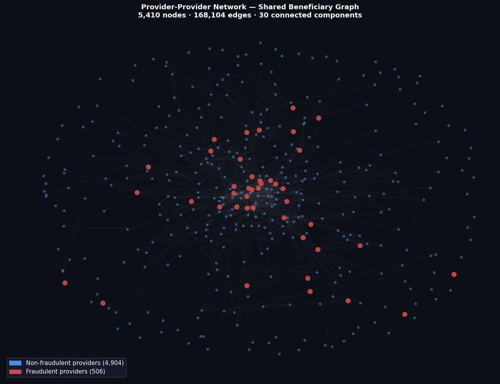
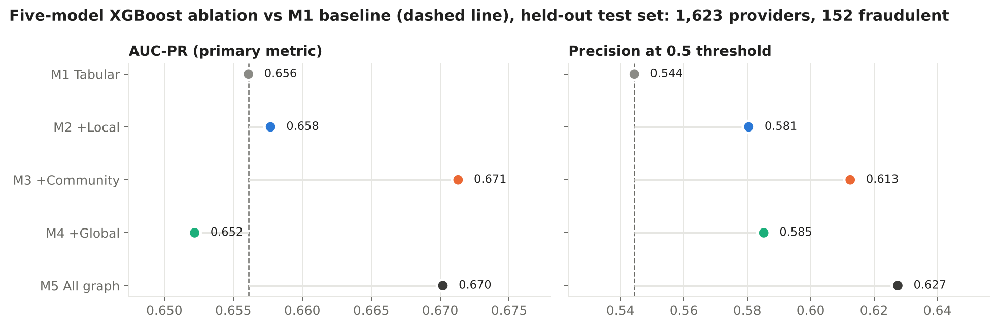
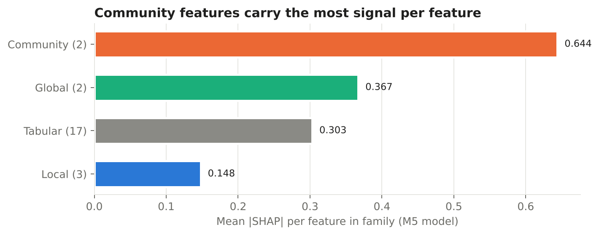
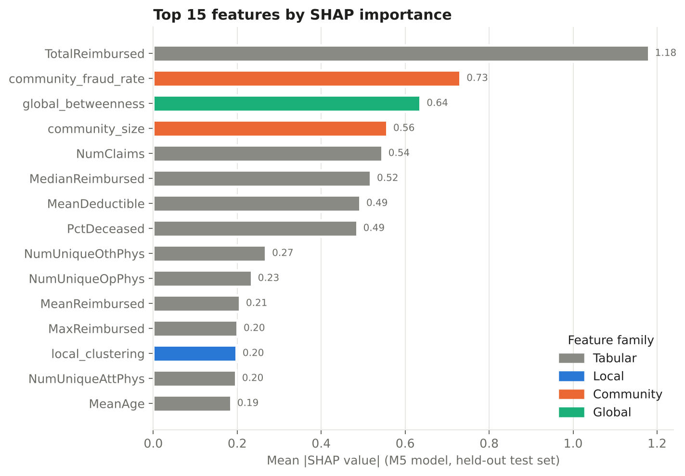
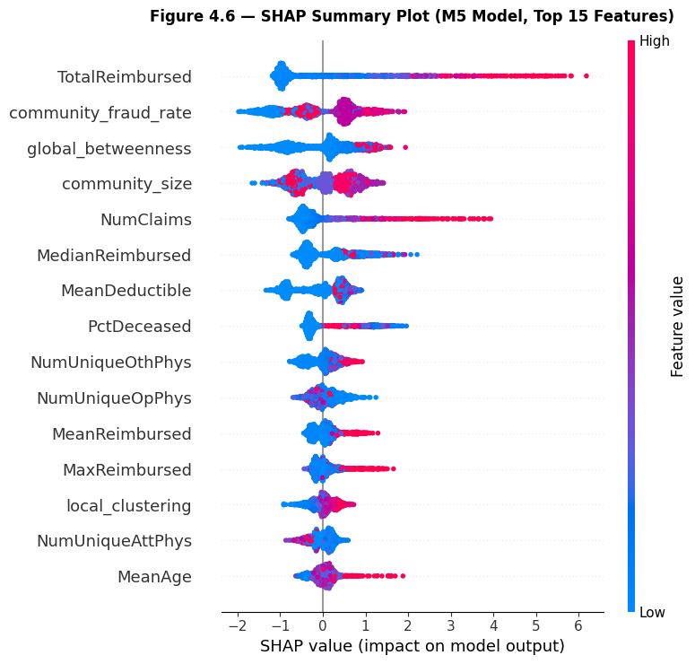
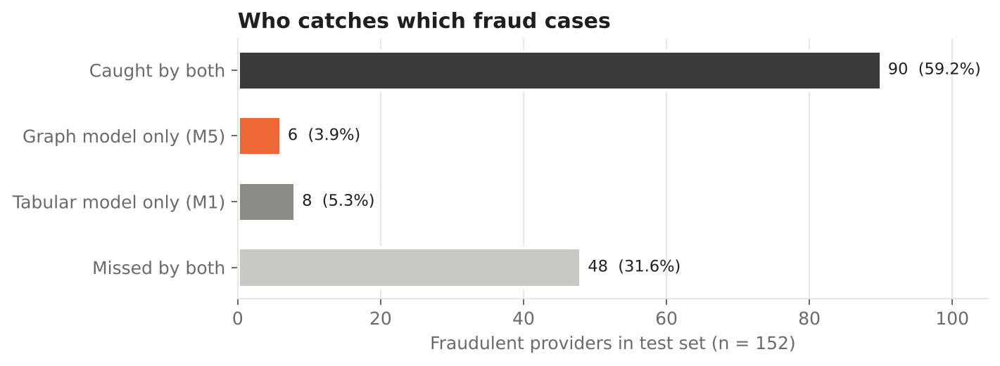

# Guilt by Association: Graph-Augmented ML for Healthcare Insurance Fraud Detection

**MSc AI & Data Science dissertation · University of East London · 2026 · Adesanmi Adetoba**

Most fraud models score each provider on its own billing record. Coordinated fraud, though, sits in the *relationships*: providers who share patients with other fraudulent providers. This project turns 558,211 Medicare claims into a provider network and tests **which kind of network information actually improves fraud detection**, using a controlled ablation, statistical significance testing and SHAP explainability.



## In 30 seconds

| | |
|---|---|
| **Data** | Kaggle *Healthcare Provider Fraud Detection Analysis* (CMS Medicare): 5,410 providers (506 fraudulent, 9.35%), 558,211 claims, 138,556 beneficiaries |
| **Graph** | Provider–provider network: two providers are linked when they treated the same beneficiary. 168,104 weighted edges, 40 Louvain communities |
| **Models** | Five XGBoost models: a 17-feature tabular baseline, then + local, + community, + global graph features, then all together. Graph construction held fixed across all five |
| **Validation** | Stratified 70/30 split, SMOTE inside CV folds only, paired bootstrap (1,000 resamples), Louvain stability across 10 seeds (ARI 0.908) |
| **Headline** | Adding graph features raised precision from **0.544 to 0.627 (+8.3 points, 95% CI +4.2 to +12.9)** with no significant change in recall: fewer false alarms for investigators at the same catch rate |
| **Key insight** | **Community features** (which provider group you sit in, and that group's fraud rate) gave the best single-family result (AUC-PR 0.671) and the highest SHAP importance per feature. Costly global centrality measures added nothing to AUC-PR |

## Why this matters for a fraud team

* A false positive costs an investigator's time. Going from 54% to 63% precision means roughly **8 fewer wasted investigations per 100 providers flagged**, without missing more fraud.
* Community features are cheap to compute (Louvain ran in ~2 s on this graph; betweenness took ~34 s even with approximation), so they are the best value-for-compute graph signal here.
* Six fraudulent providers were caught **only** by the graph model. They bill far less than typical fraud and look unremarkable on their own records; their network position is what gives them away.

## Results

### Five-model ablation (held-out test set)

| Model | Features | AUC-PR | AUC-ROC | F1 | Recall | Precision |
|---|---|---|---|---|---|---|
| M1 Tabular baseline | 17 | 0.6561 | 0.9292 | 0.5904 | 0.6447 | 0.5444 |
| M2 + Local | 20 | 0.6577 | 0.9307 | 0.6196 | 0.6645 | 0.5805 |
| M3 + Community | 19 | **0.6713** | **0.9322** | 0.6282 | 0.6447 | 0.6125 |
| M4 + Global | 19 | 0.6522 | 0.9288 | 0.6280 | **0.6776** | 0.5852 |
| M5 All graph | 24 | 0.6702 | 0.9297 | **0.6295** | 0.6316 | **0.6275** |



### Is the difference real? Paired bootstrap vs M1 (1,000 resamples)

| Comparison | AUC-PR | F1 | Recall | Precision |
|---|---|---|---|---|
| M2 + Local | +0.001 (ns) | +0.028 (ns) | +0.018 (ns) | **+0.035** |
| M3 + Community | +0.015 (ns) | **+0.038** | 0.000 (ns) | **+0.068** |
| M4 + Global | −0.002 (ns) | **+0.037** | +0.032 (ns) | **+0.041** |
| M5 All graph | +0.014 (ns) | **+0.038** | −0.014 (ns) | **+0.082** |

Bold = 95% confidence interval excludes zero. Full intervals in [`results/significance_results.csv`](results/significance_results.csv).

Reading it plainly: graph features make the model **more precise** (significant for every graph family) rather than catching more fraud overall. Ranking quality (AUC-PR) moves only slightly, so the gain is mainly a cleaner set of flagged providers at the decision threshold.

### What drives the predictions? SHAP on M5





`community_fraud_rate` is the second most important feature overall, behind only total reimbursement. Per feature, the community family carries about twice the signal of any other family.



### Who gets caught



The graph model does not simply add detections: it catches 6 fraud cases the tabular model misses and misses 8 the tabular model catches. The net effect is the precision gain above. The graph-only cases have much lower claim volume (215 vs 840 claims on average), fewer beneficiaries and non-fraud-level centrality, so they would not stand out on billing alone. See [`results/graph_only_profile.csv`](results/graph_only_profile.csv).

## Method

```
Claims (558k) ──► Provider features (17) ─────────────────────────────┐
     │                                                                 │
     └──► Shared-beneficiary provider graph (5,410 nodes, 168k edges)  │
              ├─ Local:     degree, weighted degree, clustering        │
              ├─ Community: Louvain community size, community fraud rate (train labels only)
              └─ Global:    PageRank, betweenness (k=500)              │
                                                                       ▼
                         Five-model XGBoost ablation (M1–M5)
                         SMOTE inside 5-fold CV · tuned per model
                                       │
             ┌─────────────────────────┼─────────────────────────┐
     Paired bootstrap CIs      SHAP TreeExplainer (M5)     Error analysis of
     vs M1 baseline            feature + family level      graph-only detections
```

Design choices that guard against misleading results:

* **No label leakage.** `community_fraud_rate` uses training-set labels only; test providers get their community's training rate (or the global training rate if their community has no training members).
* **No oversampling leakage.** SMOTE runs inside each CV fold on the training partition only. The test set keeps its true 9.35% fraud rate.
* **SHAP on real data.** SHAP is computed on the untouched test set with the original (non-SMOTE) training data as background.
* **Fixed graph.** One graph construction for all five models, so differences come from the feature family alone.
* **Stable communities.** Louvain across 10 seeds gives mean ARI 0.908 (min 0.850), so community features are not an artefact of one random seed.

## Repository layout

```
notebooks/graph_fraud_detection_pipeline.ipynb   full pipeline with saved outputs
results/                                         CSVs of every reported number
figures/                                         charts used in this README
src/make_figures.py                              rebuilds the charts from results/
requirements.txt
```

## Run it yourself

**On Kaggle (easiest):** create a notebook, attach the dataset *Healthcare Provider Fraud Detection Analysis* (rohitrox), upload `notebooks/graph_fraud_detection_pipeline.ipynb`, Run All. Takes a few minutes on the standard CPU runtime; the hyperparameter search and SHAP are the slowest steps.

**Locally:**

```bash
pip install -r requirements.txt
# download the four Train*.csv files from Kaggle into data/
jupyter notebook notebooks/graph_fraud_detection_pipeline.ipynb
python src/make_figures.py     # rebuild charts from results/
```

Random seed 42 is used throughout. Bootstrap intervals and the small graph-only group can shift slightly between runs and library versions; the ablation table reproduces exactly.

## Limitations

* One public benchmark and one graph construction; results are not claimed to generalise beyond it.
* Labels are provider-level "potential fraud" flags, not adjudicated case outcomes.
* The graph-only group is small (6 providers), so its profile is descriptive, not conclusive.
* SHAP values on correlated graph features should be read at family level rather than as precise per-feature attributions.

## Built with

Python · pandas · NetworkX · XGBoost · SHAP · scikit-learn · imbalanced-learn · SciPy · Matplotlib

## Citation

Adetoba, A. (2026) *Guilt by Association: A Graph-Augmented Machine Learning Approach to Insurance Fraud Detection with SHAP Explanation*. MSc dissertation, University of East London.

Dataset: Gupta, R. (2018) *Healthcare Provider Fraud Detection Analysis*. Kaggle.
